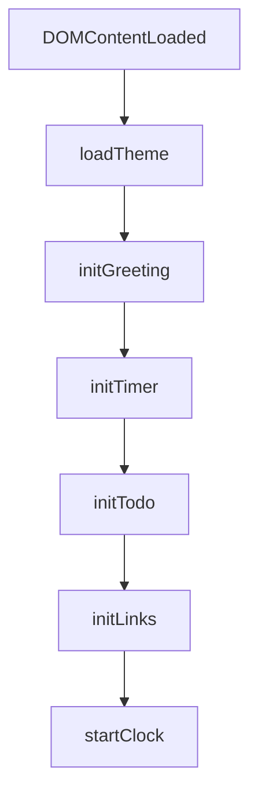

# Design Document

## Overview

The To-Do Life Dashboard is a fully self-contained, single-page web application delivered as three files: `index.html`, `css/style.css`, and `js/app.js`. It requires no build step, no npm packages, and no network access after the initial load. All state is persisted to `localStorage` under five distinct keys.

The UI is composed of four independent widgets arranged in a responsive CSS Grid layout. Each widget owns a cohesive block of HTML markup and a corresponding module-style function group in `app.js`. The light/dark theme is driven entirely by toggling a `.dark` class on `<html>` and resolving CSS custom properties, so no JavaScript style mutation is needed.

Design goals in priority order:
1. Correctness — every user action produces the specified state change and persists it.
2. Simplicity — no abstractions beyond what the feature requires; vanilla JS only.
3. Visual quality — clean, minimalistic aesthetic that works in both themes.

---

## Architecture

The application has no runtime dependencies and no module bundler. All code runs in a single browser context (global scope partitioned by naming conventions).

```
index.html          ← single HTML page, all widget markup
css/
  style.css         ← all styling; CSS custom properties for theming
js/
  app.js            ← all behavior; initialised via DOMContentLoaded
```

### Initialisation Flow



Each `init*` function reads from `localStorage`, populates the DOM, and attaches event listeners. `startClock` starts the 1 s `setInterval` that drives the live clock and greeting refresh.

### Module Boundaries (within app.js)

| Namespace prefix | Responsibility |
|---|---|
| `greeting.*` | Clock tick, greeting text, name save/load |
| `timer.*` | Countdown logic, start/stop/reset, duration config |
| `todo.*` | Task CRUD, sort, storage sync |
| `links.*` | Quick-link CRUD, storage sync |
| `theme.*` | Toggle, persist, restore |
| `storage.*` | Thin wrappers around `localStorage` with try/catch |

Functions within each group are named `greeting_tick()`, `greeting_saveName()`, etc. This flat-namespace convention keeps the code readable without requiring ES modules.

---

## Components and Interfaces

### 1. Greeting Widget

**HTML structure**
```html
<section id="greeting-widget">
  <p id="clock">00:00:00</p>
  <p id="date-display"></p>
  <p id="greeting-text"></p>
  <form id="name-form">
    <input id="name-input" maxlength="50" type="text" />
    <button type="submit">Save</button>
    <span id="name-error" role="alert"></span>
  </form>
</section>
```

**Key functions**
- `greeting_tick()` — called every 1 000 ms; updates `#clock`, `#date-display`, and `#greeting-text`.
- `greeting_getGreeting(hour)` — pure function; maps `hour` (0–23) to greeting string.
- `greeting_saveName(value)` — validates length (1–50), saves to storage, calls `greeting_tick()`.
- `greeting_formatDate(date)` — returns `"DayName, DD MonthName YYYY"` string.

**Interface contract**
```
greeting_getGreeting(hour: number) → string
greeting_formatDate(date: Date) → string
greeting_saveName(value: string) → { ok: boolean, error?: string }
```

### 2. Timer Widget

**HTML structure**
```html
<section id="timer-widget">
  <p id="timer-display">25:00</p>
  <div id="timer-controls">
    <button id="btn-start">Start</button>
    <button id="btn-stop">Stop</button>
    <button id="btn-reset">Reset</button>
  </div>
  <form id="duration-form">
    <input id="duration-input" type="number" min="1" max="999" />
    <button type="submit">Set</button>
    <span id="duration-error" role="alert"></span>
  </form>
</section>
```

**State (module-level variables)**
```
timer.intervalId      — setInterval handle, null when stopped
timer.remaining       — seconds remaining
timer.focusDuration   — current configured duration in seconds
timer.isRunning       — boolean
```

**Key functions**
- `timer_start()` — no-op if `isRunning`; sets interval.
- `timer_stop()` — clears interval, sets `isRunning = false`.
- `timer_reset()` — calls `timer_stop()`, restores `remaining` to `focusDuration`.
- `timer_tick()` — decrements `remaining`; calls `timer_onComplete()` at zero.
- `timer_setDuration(minutes)` — validates 1–999; rejects if out of range.
- `timer_formatDisplay(seconds)` — returns `"MM:SS"` string with zero-padding.
- `timer_onComplete()` — stops timer, adds `.timer-complete` class to widget.

### 3. To-Do Widget

**HTML structure**
```html
<section id="todo-widget">
  <form id="add-task-form">
    <input id="task-input" type="text" maxlength="200" />
    <button type="submit">Add</button>
    <span id="task-error" role="alert"></span>
  </form>
  <div id="sort-controls">
    <button data-sort="name">By Name (A–Z)</button>
    <button data-sort="status">By Status</button>
  </div>
  <ul id="task-list"></ul>
</section>
```

Each rendered task item:
```html
<li data-id="{id}">
  <button class="btn-complete" aria-label="Toggle complete"></button>
  <span class="task-text"></span>
  <button class="btn-edit" aria-label="Edit"></button>
  <button class="btn-delete" aria-label="Delete"></button>
</li>
```

**Key functions**
- `todo_add(description)` — validates 1–200 chars, appends task, persists.
- `todo_delete(id)` — removes task by id, persists.
- `todo_toggle(id)` — flips `completed`, persists.
- `todo_startEdit(id)` — replaces `<span>` with `<input>` pre-filled with current text.
- `todo_saveEdit(id, value)` — validates, updates, persists; reverts on empty.
- `todo_sort(mode)` — sorts in-memory array; `'name'` = case-insensitive alpha, `'status'` = incomplete first.
- `todo_render()` — full re-render of `#task-list` from in-memory array.
- `todo_persist()` — writes array to `localStorage`.
- `todo_load()` — reads array from `localStorage`, calls `todo_render()`.

### 4. Quick Links Widget

**HTML structure**
```html
<section id="links-widget">
  <div id="links-list"></div>
  <form id="add-link-form">
    <input id="link-label" type="text" maxlength="50" />
    <input id="link-url" type="url" />
    <button type="submit">Add Link</button>
    <span id="link-error" role="alert"></span>
  </form>
</section>
```

Each rendered link button:
```html
<div class="link-item">
  <a href="{url}" target="_blank" rel="noopener noreferrer">{label}</a>
  <button class="btn-delete-link" aria-label="Delete link"></button>
</div>
```

**Key functions**
- `links_add(label, url)` — validates label (1–50), URL (`http://` or `https://` + domain), max 20 items; persists.
- `links_delete(id)` — removes by id, persists.
- `links_validateUrl(url)` — returns `{ ok: boolean, error?: string }`.
- `links_render()` — full re-render of `#links-list`.
- `links_persist()` / `links_load()` — storage sync.

### 5. Theme Toggle

```html
<button id="theme-toggle" aria-label="Toggle dark mode"></button>
```

- `theme_toggle()` — flips `.dark` class on `<html>`, persists to storage.
- `theme_load()` — reads stored theme; falls back to `prefers-color-scheme` if unset.

---

## Data Models

### localStorage Keys

| Key | Type | Description |
|---|---|---|
| `tld_tasks` | `Task[]` (JSON) | All to-do tasks |
| `tld_links` | `QuickLink[]` (JSON) | All quick links |
| `tld_name` | `string` | User display name |
| `tld_focusDuration` | `number` | Focus duration in minutes |
| `tld_theme` | `"light" \| "dark"` | Active theme |

The `tld_` prefix namespaces the keys to avoid collisions with other applications on the same origin.

### Task

```ts
interface Task {
  id: string;          // crypto.randomUUID() or Date.now().toString()
  description: string; // 1–200 characters
  completed: boolean;
  createdAt: number;   // Unix timestamp ms
}
```

### QuickLink

```ts
interface QuickLink {
  id: string;    // unique identifier
  label: string; // 1–50 characters
  url: string;   // must start with http:// or https://
}
```

### CSS Custom Properties (Theme)

All color and surface values are defined as CSS custom properties on `:root` with `.dark` overrides:

```css
:root {
  --bg-primary: #ffffff;
  --bg-surface: #f5f5f5;
  --text-primary: #1a1a1a;
  --text-secondary: #555555;
  --accent: #4f8ef7;
  --border: #dddddd;
  --shadow: rgba(0,0,0,0.08);
  --timer-complete-bg: #fde8e8;
}

.dark {
  --bg-primary: #121212;
  --bg-surface: #1e1e1e;
  --text-primary: #f0f0f0;
  --text-secondary: #aaaaaa;
  --accent: #6ea8fe;
  --border: #333333;
  --shadow: rgba(0,0,0,0.4);
  --timer-complete-bg: #3d1f1f;
}
```

### Responsive Layout

```css
/* Mobile-first base: single column */
#dashboard-grid {
  display: grid;
  grid-template-columns: 1fr;
  gap: 1.5rem;
  padding: 1rem;
}

/* Multi-column at ≥768px */
@media (min-width: 768px) {
  #dashboard-grid {
    grid-template-columns: repeat(2, 1fr);
  }
}
```

The Todo widget spans both columns on wide screens (`grid-column: 1 / -1`) since its content grows vertically.

---

## Correctness Properties

*A property is a characteristic or behavior that should hold true across all valid executions of a system — essentially, a formal statement about what the system should do. Properties serve as the bridge between human-readable specifications and machine-verifiable correctness guarantees.*

### Property 1: Greeting range covers all 24 hours

*For any* integer hour in [0, 23], `greeting_getGreeting(hour)` returns exactly one of "Good Morning", "Good Afternoon", "Good Evening", or "Good Night", and the ranges are non-overlapping and exhaustive.

**Validates: Requirements 1.3, 1.4, 1.5, 1.6**

---

### Property 2: Greeting text includes saved name

*For any* valid name string (1–50 characters) and any hour in [0, 23], `greeting_buildText(hour, name)` returns a string that contains the name and ends with "!".

**Validates: Requirements 1.7**

---

### Property 3: Time format is always HH:MM:SS

*For any* `Date` object, `greeting_formatTime(date)` returns a string matching the pattern `^\d{2}:\d{2}:\d{2}$` where the two-digit groups correspond to the date's hours, minutes, and seconds respectively.

**Validates: Requirements 1.1**

---

### Property 4: Date format matches expected structure

*For any* `Date` object, `greeting_formatDate(date)` returns a string of the form `"DayName, DD MonthName YYYY"` where DayName and MonthName match the date's actual day-of-week and month, DD matches the day-of-month zero-padded to two digits, and YYYY matches the full year.

**Validates: Requirements 1.2**

---

### Property 5: Name save accepts exactly 1–50 character strings

*For any* string of 1–50 characters, `greeting_saveName(value)` returns `{ ok: true }` and stores the value. *For any* string of 0 characters or more than 50 characters, it returns `{ ok: false }` and does not modify the stored name.

**Validates: Requirements 1.9, 1.10, 1.11**

---

### Property 6: Timer display is always valid MM:SS

*For any* non-negative integer representing seconds, `timer_formatDisplay(seconds)` returns a string matching `^\d{2}:\d{2}$` where the minute component equals `Math.floor(seconds / 60)` zero-padded to two digits and the second component equals `seconds % 60` zero-padded to two digits.

**Validates: Requirements 2.2, 2.7**

---

### Property 7: Adding a valid task grows the list by one

*For any* task list and any non-empty description string of 1–200 characters, calling `todo_add(description)` increases the task list length by exactly one, and the new task's description equals the input.

**Validates: Requirements 3.1**

---

### Property 8: Completion toggle is its own inverse

*For any* task, calling `todo_toggle(id)` twice in succession leaves the task's `completed` field unchanged from its initial value.

**Validates: Requirements 3.4**

---

### Property 9: Sort by name produces case-insensitive ascending order

*For any* array of tasks, after `todo_sort('name')`, for every adjacent pair at indices `i` and `i+1`, `tasks[i].description.toLowerCase() <= tasks[i+1].description.toLowerCase()`.

**Validates: Requirements 3.9**

---

### Property 10: Sort by status places all incomplete tasks before completed tasks

*For any* array of tasks, after `todo_sort('status')`, there exists an index `k` such that all tasks at indices `< k` have `completed === false` and all tasks at indices `>= k` have `completed === true`. The relative order of tasks within each group is preserved.

**Validates: Requirements 3.10**

---

### Property 11: Task persistence round-trip

*For any* array of `Task` objects, calling `todo_persist(tasks)` then `todo_load()` returns an array structurally equal to the original (same ids, descriptions, and completion states).

**Validates: Requirements 3.11, 7.1**

---

### Property 12: Adding a valid quick link grows the list by one

*For any* label of 1–50 characters and URL starting with `http://` or `https://` containing a valid domain, `links_add(label, url)` increases the quick-links list length by exactly one and the new entry's label and url match the inputs.

**Validates: Requirements 4.1**

---

### Property 13: Deleting a quick link removes it from the list

*For any* quick-links list and any `id` present in that list, calling `links_delete(id)` produces a list that contains no entry with that `id`, and all other entries remain unchanged.

**Validates: Requirements 4.4**

---

### Property 14: Quick-links persistence round-trip

*For any* array of `QuickLink` objects, calling `links_persist(links)` then `links_load()` returns an array structurally equal to the original (same ids, labels, and URLs).

**Validates: Requirements 4.5, 7.1**

---

### Property 15: Theme toggle is its own inverse

*For any* initial theme state, calling `theme_toggle()` twice returns the `<html>` element's class list to its original state.

**Validates: Requirements 5.2**

---

### Property 16: Theme persistence round-trip

*For any* theme value (`"light"` or `"dark"`), calling `theme_save(value)` then `theme_load()` applies that theme to the document (adds or removes the `.dark` class on `<html>` accordingly).

**Validates: Requirements 5.3, 5.4**

---

## Error Handling

### Storage unavailability

All `localStorage` access is wrapped in a `storage_*` helper layer with try/catch. If `localStorage` throws (e.g., in private-browsing mode with storage blocked), the helper returns a typed error result. Each widget checks this result:
- On load failure: render an empty state and display a persistent banner: "Storage unavailable — data will not be saved this session."
- On save failure: display a transient inline error near the affected widget.
- The widget continues functioning in-memory so the user is not blocked.

### Input validation errors

Validation is performed before any state mutation. Each widget's add/edit/save function returns `{ ok: boolean, error?: string }`. On `ok: false`, the calling code:
1. Does not modify in-memory state.
2. Does not call `persist()`.
3. Populates the widget's `role="alert"` error span with the error message.
4. Clears the error on the next valid submission.

### Timer edge cases

- If `remaining` somehow reaches a value less than zero (e.g., due to rapid DOM manipulation in tests), `timer_tick()` clamps it to 0 and calls `timer_onComplete()`.
- Starting an already-running timer is a no-op; no second `setInterval` is created.

### Quick-link URL validation

`links_validateUrl(url)` uses a two-step check:
1. String prefix check for `http://` or `https://`.
2. `new URL(url)` construction inside a try/catch; if it throws, the URL is invalid.
This avoids a complex regex while handling edge cases like `https://` with no domain.

---

## Testing Strategy

### Approach

This feature is a pure-client, no-dependency application whose testable logic lives in pure and near-pure functions. The testing strategy uses two complementary layers:

1. **Property-based tests** — for universal properties (see Correctness Properties section) using a PBT library.
2. **Example-based unit tests** — for specific examples, edge cases, and integration points.

UI rendering and browser-side effects (focus, `window.open`, `matchMedia`) are tested via example-based tests with DOM assertions using jsdom.

### PBT Library

[fast-check](https://fast-check.dev/) is the chosen PBT library for JavaScript. It is a development-only dependency and does not appear in the application bundle (the runtime ships zero dependencies).

Each property test is configured with a minimum of 100 runs:
```js
fc.assert(fc.property(...), { numRuns: 100 });
```

Each test is tagged with a comment:
```js
// Feature: todo-life-dashboard, Property 1: Greeting range covers all 24 hours
```

### Test File Layout

```
tests/
  greeting.test.js   — Properties 1–5, greeting examples
  timer.test.js      — Property 6, timer examples and edge cases
  todo.test.js       — Properties 7–11, todo examples and edge cases
  links.test.js      — Properties 12–14, links examples and edge cases
  theme.test.js      — Properties 15–16, theme examples
  storage.test.js    — Storage error handling edge cases
```

### Unit Testing Focus Areas

- Each widget's validation path (empty input, too-long input, out-of-range numbers)
- Timer state machine transitions (start → stop → reset → complete)
- `links_validateUrl` with edge-case URLs (`ftp://`, `https://` with no host, bare domains)
- `theme_load` fallback to `prefers-color-scheme` when no stored value exists
- `storage_*` helpers return typed errors on `localStorage` exceptions

### What Is Not Unit-Tested

- CSS layout and responsive breakpoints — verified by visual inspection or browser dev tools.
- 1-second timer accuracy — the interval scheduling is a browser concern; tests verify the tick logic, not wall-clock precision.
- Cross-browser compatibility (Requirement 7.2) — verified manually in Chrome, Firefox, Edge, and Safari.
